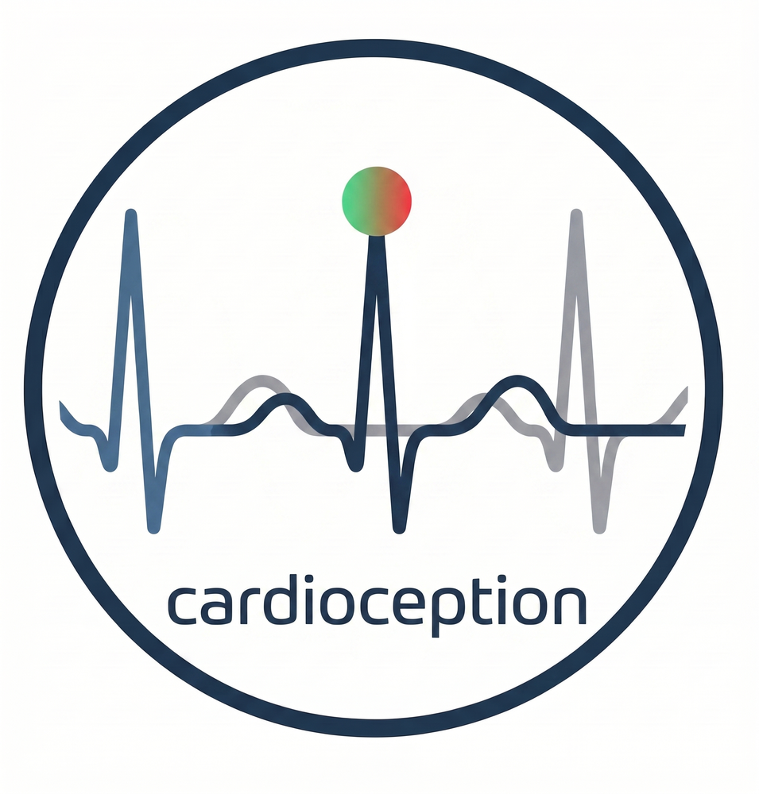
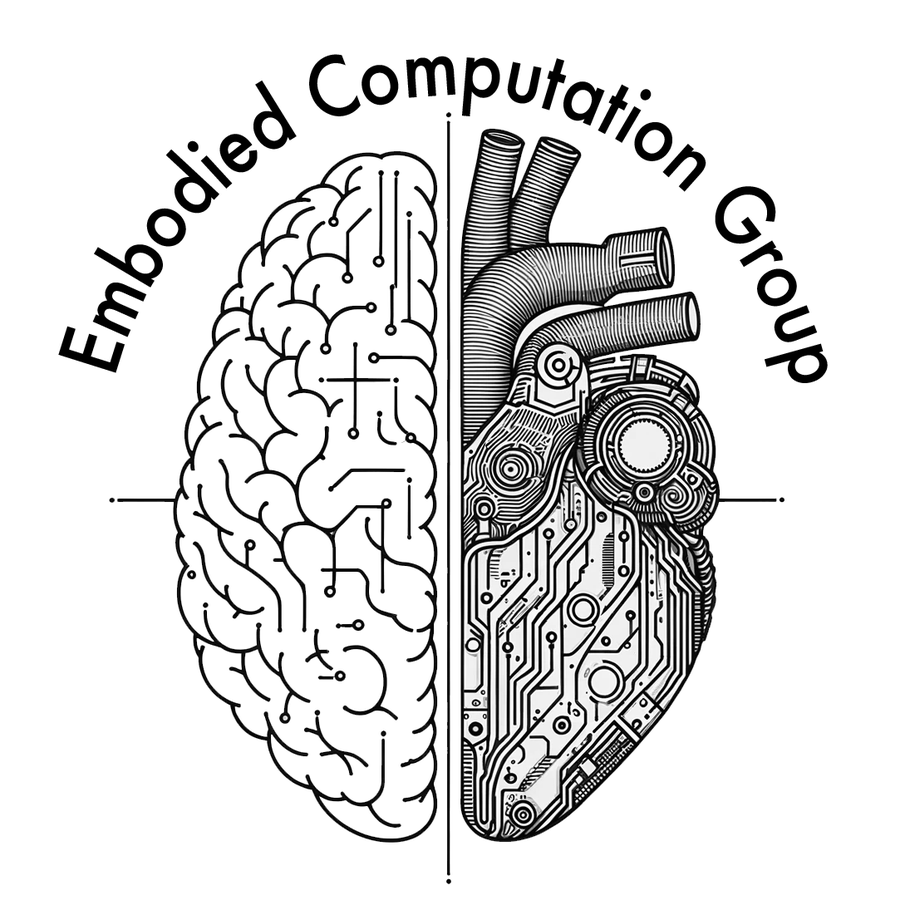

[](https://pypi.org/project/cardioception-toolbox/) [](https://github.com/embodied-computation-group/Cardioception/actions/workflows/tests.yml) [](https://github.com/embodied-computation-group/Cardioception/blob/main/LICENSE) [](https://doi.org/10.5281/zenodo.22139105)

# Cardioception



**Cardioception is an all-in-one, open-source Python toolbox for studying how people perceive their own heartbeat.**

Version 1.0 rebuilds the package around a shared core and brings the most widely used methods for measuring cardiac interoception together in one place: heart rate discrimination, heartbeat counting, the Phase Adjustment Task, and a new adaptive Heartbeat Synchrony Discrimination task for the perceived timing of individual heartbeats. The classic Whitehead and Brener synchrony methods come next. One installation, one output layout and one set of tutorials let you study perceptual bias, precision and confidence across methods, and compare them in the same participants.

Built on [PsychoPy](https://www.psychopy.org/), Cardioception combines task presentation with physiological recording, from a USB pulse oximeter or from compatible ECG and PPG devices connected through [Lab Streaming Layer](https://labstreaminglayer.org/) (LSL). Ready-to-run scripts, participant tutorials and [documentation](https://www.the-ecg.org/Cardioception/) help you set up and run an experiment.

This is the official Cardioception, developed by Micah Allen and the Embodied Computation Group at Aarhus University, and the version used in the publications listed below.

## The tasks

| Task | What participants do | Main measures | Reference | Status |
|---|---|---|---|---|
| Heart Rate Discrimination (HRD) | Judge whether a sequence of tones is faster or slower than their own heart rate | Bias and precision of heart rate judgements, with optional confidence ratings | [Legrand et al., 2022](https://doi.org/10.1016/j.biopsycho.2021.108239) | Established |
| Heartbeat Counting (HBC) | Count their heartbeats during intervals of different lengths | Reported heartbeat counts relative to recorded counts | [Schandry, 1981](https://doi.org/10.1111/j.1469-8986.1981.tb02486.x) | Established |
| Phase Adjustment Task (PAT) | Adjust the delay of tones until they match their perceived heartbeat | The delay chosen, and its consistency across trials | [Plans et al., 2021](https://doi.org/10.1016/j.biopsycho.2021.108171); ECG version after [Hodgetts et al., 2026](https://doi.org/10.1111/psyp.70415) | Beta |
| Heartbeat Synchrony Discrimination (HSD) | Judge whether tones played at different delays after each heartbeat are synchronous with it | Perceived timing of the heartbeat, and its temporal precision | New in Cardioception; see the [design page](https://www.the-ecg.org/Cardioception/tasks/hsd/design.html) | Beta |
| Whitehead method | Judge which of two tone sequences, one at a short and one at a longer delay after each heartbeat, is simultaneous with it | Discrimination of synchronous from delayed tones | [Whitehead et al., 1977](https://doi.org/10.1007/BF00998623) | Coming soon |
| Method of constant stimuli (Brener) | Judge whether tones at one of several fixed delays, from 0 to 500 ms after each heartbeat, are simultaneous with it | Proportion of tones judged simultaneous at each delay | [Brener, Liu & Ring, 1993](https://doi.org/10.1111/j.1469-8986.1993.tb02091.x) | Coming soon |

Tasks in beta are close to feature complete and are still being rigorously validated.

The HRD and the HBC run with a USB pulse oximeter or with an ECG or PPG device over LSL. The synchrony tasks time each tone from the R-wave, so they need an ECG over LSL.

[The tasks](https://www.the-ecg.org/Cardioception/tasks/index.html) page compares the four available tasks in detail. The [theory](https://www.the-ecg.org/Cardioception/tasks/theory.html) page explains what each can and cannot establish.

## Installation

Cardioception needs Python 3.10 or 3.11.

```
pip install cardioception-toolbox
```

Check that the name you install is exactly `cardioception-toolbox`. For ECG or PPG over LSL, install the extra as well: `pip install "cardioception-toolbox[lsl]"`.

The [installation guide](https://www.the-ecg.org/Cardioception/getting-started/installation.html) goes step by step from a fresh machine to a checked pulse signal, and covers conda, earlier versions and troubleshooting.

## Try the HRD without recording hardware

```python
from cardioception.HRD.parameters import getParameters
from cardioception.HRD import task

# setup="test" replays a recorded pulse, so this runs without hardware.
# For a real session, use setup="behavioral" and the oximeter's serial port.
parameters = getParameters(participant="sub01", session="pilot", setup="test", nTrials=10)
task.run(parameters, confidenceRating=True, runTutorial=True)
parameters["win"].close()
```

Every task writes to `data/sub-<participant>/ses-<session>/run-<timestamp>/`, with one row per trial in `*_final.txt`. The [wrappers](wrappers/) folder has a ready-to-run script for each task. [Running a session](https://www.the-ecg.org/Cardioception/getting-started/running-a-session.html) covers what every session shares: the wrappers, the output layout, languages and confidence scales. [Recording devices](https://www.the-ecg.org/Cardioception/getting-started/recording-devices.html) covers the oximeter and LSL devices, and each task's page its own settings.

## Analysis

For hierarchical modelling and power analysis of HRD data, see the companion [Hierarchical Interoception toolbox](https://github.com/embodied-computation-group/Hierarchical-Interoception), described in [Courtin et al. (2026)](https://doi.org/10.3758/s13428-026-03137-3). It provides validated psychometric models and normative priors. The R scripts in [`R_analysis/`](R_analysis/) are kept working for existing pipelines, and the older Python report notebooks in `cardioception/notebooks/` remain for reference.

## Documentation

- [Installation](https://www.the-ecg.org/Cardioception/getting-started/installation.html): from a fresh machine to a first session
- [Recording devices](https://www.the-ecg.org/Cardioception/getting-started/recording-devices.html) and [running a session](https://www.the-ecg.org/Cardioception/getting-started/running-a-session.html): connecting a device, and what every session shares
- [The tasks](https://www.the-ecg.org/Cardioception/tasks/index.html) and [theory](https://www.the-ecg.org/Cardioception/tasks/theory.html): what each task measures and when to use it
- [Phase Adjustment Task](https://www.the-ecg.org/Cardioception/tasks/pat.html) and [HSD design](https://www.the-ecg.org/Cardioception/tasks/hsd/design.html): the two tasks in beta
- [API reference](https://www.the-ecg.org/Cardioception/reference/api.html)
- [Changelog](CHANGELOG.md): what changed in 1.0, and how to migrate scripts written for 0.7

## How to cite

If you use Cardioception, please cite:

> Legrand, N., Nikolova, N., Correa, C., Brændholt, M., Stuckert, A., Kildahl, N., Vejlø, M., Fardo, F., & Allen, M. (2022). The heart rate discrimination task: A psychophysical method to estimate the accuracy and precision of interoceptive beliefs. *Biological Psychology*, 168, 108239. <https://doi.org/10.1016/j.biopsycho.2021.108239>

To refer to a specific version of the software, use its [Zenodo DOI](https://doi.org/10.5281/zenodo.22139105). [`CITATION.cff`](CITATION.cff) has both, and the [citation page](https://www.the-ecg.org/Cardioception/reference/cite.html) has BibTeX entries.

## Publications using the HRD

If your work is missing, open an issue or a pull request and we will add it.

- Banellis, L., Nikolova, N., Ehmsen, J. F., Courtin, A. S., Vejlø, M., Tyrer, A., Böhme, R. A., Bavato, F., Hoogervorst, K., Fardo, F., & Allen, M. G. (2026). Interoceptive performance is unrelated to mental health symptoms in a large multi-domain psychophysical investigation. *Nature Mental Health*, 1–15. <https://doi.org/10.1038/s44220-026-00688-4>
- Courtin, A. S., Ehmsen, J. F., Banellis, L., Fardo, F., & Allen, M. G. (2026). Hierarchical Bayesian modeling of interoceptive psychophysics. *Behavior Research Methods*, 58(9), 260. <https://doi.org/10.3758/s13428-026-03137-3>
- Desdentado, L., Allen, M. G., Schultze, J., Banellis, L., Navarro-Siurana, J., Nikolova, N., Baños, R. M., & Pollatos, O. (2026). Cardiac interoception in action: Modulation after a stress induction with a speech task. *Biological Psychology*, 205, 109228. <https://doi.org/10.1016/j.biopsycho.2026.109228>
- Jeganathan, J., Campbell, M. E. J., Legrand, N., Allen, M., & Breakspear, M. (2025). Aberrant cardiac interoception in psychosis. *Schizophrenia Bulletin*, 51(1), 208–216. <https://doi.org/10.1093/schbul/sbae078>
- Tyrer, A., Ehmsen, J. F., Hoogervorst, K., Nikolova, N., Pando-Naude, V., Steenkjær, C. H., Courtin, A. S., Fardo, F., Hauser, T., Bavato, F., & Allen, M. (2025). Peripheral beta-blockade differentially enhances cardiac and respiratory interoception. *bioRxiv*. <https://doi.org/10.1101/2025.02.28.640776>
- Leganes-Fonteneau, M. (2024). Alcohol effects on interoception shape expectancies and subjective effects: A registered report using the heart rate discrimination task. *Alcohol and Alcoholism*, 59(4), agae025. <https://doi.org/10.1093/alcalc/agae025>

## Help

Report bugs and ask questions in the [issue tracker](https://github.com/embodied-computation-group/Cardioception/issues). For questions about the tasks and study design, contact Micah Allen at micah@cfin.au.dk. To contribute code or documentation, see [CONTRIBUTING.md](CONTRIBUTING.md).

## Credit

Cardioception is developed by Micah Allen and the Embodied Computation Group, Aarhus University, and was originally funded by a Lundbeckfonden Fellowship to Micah Allen. It is released under the [Apache 2.0 licence](LICENSE). Some icons come from [Flaticon](https://www.flaticon.com).


