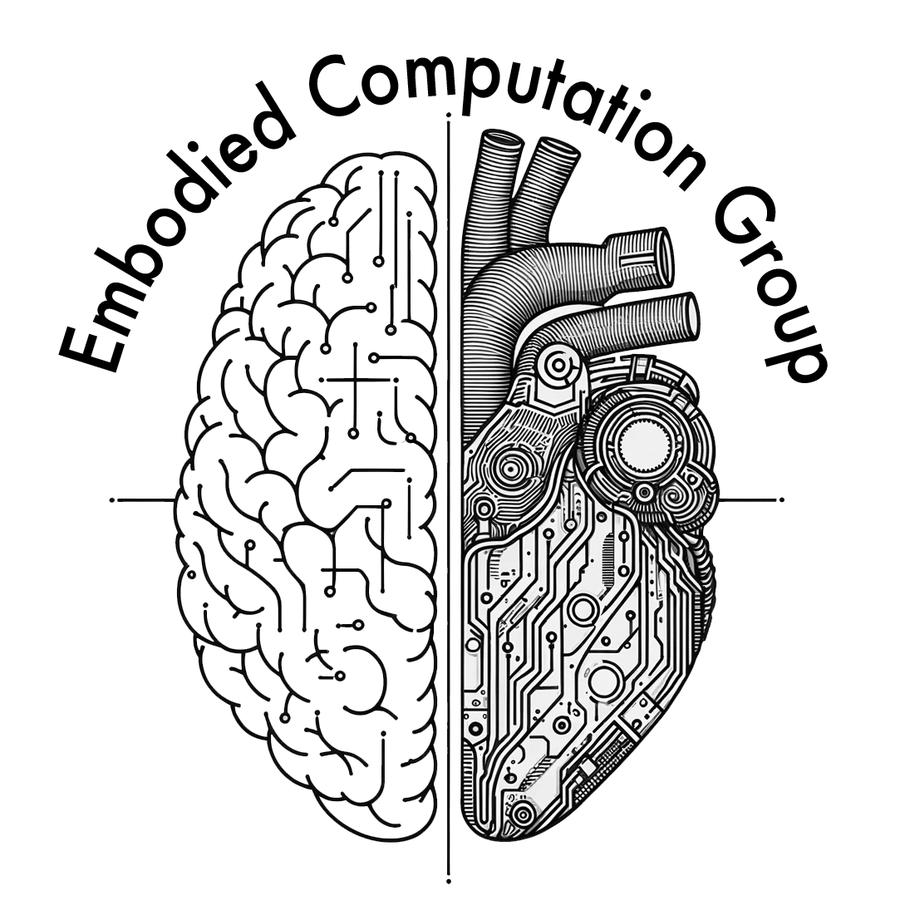

---
# The page opens with badge images, whose alt text is what sphinxext-opengraph
# would otherwise scrape into the preview description. These two keys override
# it. The released version is deliberately not repeated here: it is in the
# <title>, which reads it from the package and so cannot go stale.
og:title: "Cardioception Toolbox - Cardiac Interoception in PsychoPy"
og:description: "Official documentation for Cardioception, the Aarhus University toolbox that brings the most widely used cardiac interoception tasks together in PsychoPy."
myst:
  html_meta:
    description: "Official documentation for Cardioception, the Aarhus University toolbox that brings the most widely used cardiac interoception tasks together in PsychoPy."
    keywords: "cardioception, interoception, cardiac interoception, heart rate discrimination, HRD, heartbeat counting, heartbeat synchrony, phase adjustment task, psychophysics, metacognition, PsychoPy"
---

# Cardioception Toolbox

Cardioception is an open-source Python toolbox for studying how people perceive their own heartbeat. Built on [PsychoPy](https://www.psychopy.org/), it provides four tasks: Heart Rate Discrimination, Heartbeat Counting, the Phase Adjustment Task, and Heartbeat Synchrony Discrimination.

The tasks examine different aspects of cardiac perception, from judgements of heart rate to the perceived timing of individual beats. They share a common session setup and output directory structure. The task pages explain each method's procedure, measures, and limitations; the HRD tutorials cover data inspection and analysis.

[](https://github.com/embodied-computation-group/Cardioception/releases/) [](https://pypi.org/project/cardioception-toolbox/) [](https://github.com/embodied-computation-group/Cardioception/blob/main/LICENSE) [](https://doi.org/10.5281/zenodo.22139105)

```{note}
This is the official Cardioception, developed by Micah Allen and the Embodied Computation Group at Aarhus University, and originally funded by a Lundbeckfonden Fellowship to Micah Allen. It is the version cited in the publications listed on the [cite page](reference/cite.md).
```

## The tasks

| Task | What participants do | Main measures | Reference | Status |
|---|---|---|---|---|
| [Heart Rate Discrimination (HRD)](tasks/hrd/index.md) | Judge whether a sequence of tones is faster or slower than their own heart rate | Bias and precision of heart rate judgements, with optional confidence ratings | [Legrand et al., 2022](https://doi.org/10.1016/j.biopsycho.2021.108239) | Established |
| [Heartbeat Counting (HBC)](tasks/hbc.md) | Count their heartbeats during intervals of different lengths | Reported heartbeat counts relative to recorded counts | [Schandry, 1981](https://doi.org/10.1111/j.1469-8986.1981.tb02486.x) | Established |
| [Phase Adjustment Task (PAT)](tasks/pat.md) | Adjust the delay of tones until they match their perceived heartbeat | The delay chosen, and its consistency across trials | [Plans et al., 2021](https://doi.org/10.1016/j.biopsycho.2021.108171); ECG version after [Hodgetts et al., 2026](https://doi.org/10.1111/psyp.70415) | Beta |
| [Heartbeat Synchrony Discrimination (HSD)](tasks/hsd/index.md) | Judge whether tones played at different delays after each heartbeat are synchronous with it | Perceived timing of the heartbeat, and its temporal precision | New in Cardioception; see the [design page](tasks/hsd/design.md) | Beta |
| [Whitehead method](tasks/whitehead.md) | Judge which of two tone sequences, one at a short and one at a longer delay after each heartbeat, is simultaneous with it | Discrimination of synchronous from delayed tones | [Whitehead et al., 1977](https://doi.org/10.1007/BF00998623) | Coming soon |
| [Method of constant stimuli (Brener)](tasks/constant-stimuli.md) | Judge whether tones at one of several fixed delays, from 0 to 500 ms after each heartbeat, are simultaneous with it | Proportion of tones judged simultaneous at each delay | [Brener, Liu & Ring, 1993](https://doi.org/10.1111/j.1469-8986.1993.tb02091.x) | Coming soon |

Tasks in beta are close to feature complete and are still being rigorously validated.

The HRD and the HBC run with a USB pulse oximeter or with an ECG or PPG device over Lab Streaming Layer. The synchrony tasks time each tone from the R-wave, so they need an ECG over LSL. [The tasks](tasks/index.md) page sets the four available tasks side by side and explains what each can and cannot establish.

## Where to go

To get started, [install the package](getting-started/installation.md), [connect a recording device](getting-started/recording-devices.md), then [run a session](getting-started/running-a-session.md). Each task page describes its procedure, parameters, and output files.

The [changelog](reference/changelog.md) lists what changed in 1.0 and how to migrate scripts written for 0.7.

## Analyzing your data

Cardioception collects data; it does not analyze it. For HRD data, the companion [Hierarchical Interoception toolbox](https://github.com/embodied-computation-group/Hierarchical-Interoception), described in [Courtin et al. (2026)](https://doi.org/10.3758/s13428-026-03137-3), provides validated psychometric models and normative priors. The [tutorials](tasks/hrd/tutorials/index.md) walk through the workflow, from checking your data to fitting hierarchical models with covariates.

## Help

Report bugs and ask questions in the [issue tracker](https://github.com/embodied-computation-group/Cardioception/issues). For questions about the tasks and study design, contact Micah Allen at micah@cfin.au.dk.



```{toctree}
---
caption: Getting started
hidden:
---
Installation <getting-started/installation.md>
Recording devices <getting-started/recording-devices.md>
Running a session <getting-started/running-a-session.md>
```

```{toctree}
---
caption: Tasks
hidden:
---
tasks/index.md
tasks/theory.md
tasks/hrd/index.md
tasks/hbc.md
tasks/pat.md
tasks/hsd/index.md
tasks/whitehead.md
tasks/constant-stimuli.md
```

```{toctree}
---
caption: Reference
hidden:
---
API <reference/api.rst>
reference/cite.md
References <reference/references.md>
Changelog <reference/changelog.md>
```
