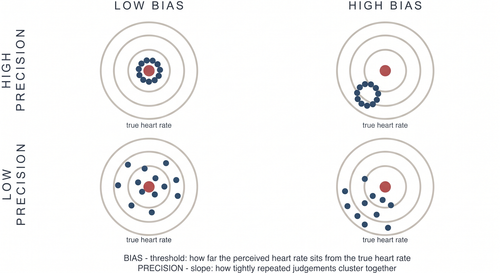

---
myst:
  html_meta:
    description: "What the Heart Rate Discrimination and Heartbeat Counting tasks measure, and why the HRD separates interoceptive bias from interoceptive precision."
    keywords: "cardiac interoception, heart rate discrimination, heartbeat counting, interoceptive accuracy, interoceptive precision, psychophysics"
---

# Theory

Author: Micah G. Allen

## Why the HRD measures cardiac beliefs

The HRD treats a person's estimate of their heart rate as the target of
measurement. This choice is motivated by both the limitations of existing tasks
and a computational account of interoception.

### Interoception involves inference

Predictive processing models describe interoception as inference about bodily
state. The nervous system combines visceral evidence with prior expectations,
with their relative influence depending on estimated precision
{cite:p}`2018:allen_friston,2018:allen_tsakiris,2021:petzschner`. Affect, context,
and anticipated physiological demands can also shape this process. Related work
has developed these ideas as candidate mechanisms for psychiatric and
psychosomatic symptoms {cite:p}`2018:owens`.

On this account, a report about the heart reflects an estimate formed from
several sources of information. Prior beliefs are part of the perceptual process
we want to understand. They cannot be treated only as contamination between an
afferent signal and a verbal response.

The measurement claim is behavioural. The HRD estimates the bias and precision
expressed in repeated perceptual judgements. Identifying a neural prior or
afferent precision requires additional measurements and experimental
manipulations. HRD parameters can be related to physiological, neural, or
clinical variables when the study design supports that inference.

### From repeated judgements to a psychometric function

Experimental work on heart-rate discrimination dates to the 1960s and includes
studies of exercise, training, and heart-rate control
{cite:p}`1960:mandler,1977:whitehead,1981:jones,1982:grigg`. The HRD revisits this
question with an adaptive psychophysical procedure {cite:p}`2022:legrand`.

On a cardiac trial, the participant attends to their heart and then hears a tone
sequence. The tones are faster or slower than the heart rate measured during the
listening interval. The participant chooses "faster" or "slower," and the task
adjusts the difference in BPM across trials. An exteroceptive trial uses the same
judgement between two tone sequences.

The probability of a "faster" response is modelled as a function of the exact
stimulus difference. This separates two properties that an accuracy score mixes
together:

- The threshold is the point of subjective equality. It measures signed bias in
  the participant's estimate of heart rate. A negative threshold indicates that
  the participant judged a tone below the recorded heart rate as equal to it.
- The psychometric slope describes how sharply choices change around the
  threshold. A steeper transition indicates more precise discrimination. Check
  the parameterization when reporting a model because the online Psi value and
  the offline model encode slope in opposite directions.

The dartboard is an analogy for these two properties. The centre of a cluster
represents bias and its spread represents precision. Although the diagram uses
repeated point estimates, the HRD identifies the corresponding centre and spread
from binary choices across stimulus intensities. A participant can show little
bias and poor precision, or substantial bias and high precision. The psychometric
function distinguishes these cases.

The scientific model also includes a lapse rate. Lapses describe responses that
are weakly related to stimulus intensity and prevent an occasional mistake at an
easy intensity from distorting the estimated threshold or slope. Lapse rate is a
feature of the response process, not a measure of interoceptive ability.

### Confidence adds a separate measurement problem

The HRD records confidence after each choice. These ratings support two distinct
questions. Overall confidence describes metacognitive bias. In the ordered beta
model, the difference in confidence between correct and incorrect trials describes
metacognitive calibration.

We use calibration specifically for the `Accuracy` coefficient and its interactions
in this model. We reserve metacognitive sensitivity and efficiency for quantities
derived from an SDT model, such as meta-$d'$ and the M-ratio
{cite:p}`2014:fleming`.

We also no longer recommend the M-ratio for this task. Psi samples stimuli around
each participant's subjective equality point, while accuracy is scored relative
to the recorded heart rate. As bias increases, the type-1 response table needed
for d-prime and meta-d-prime becomes increasingly unbalanced. The resulting
ratio is least stable for participants with the largest cardiac biases. Our
current analysis models the 0 to 100 ratings directly with ordered beta regression,
retaining responses at both bounds {cite:p}`2023:kubinec`. The
[metacognition tutorial](tutorials/metacognition.md) develops this analysis.

### The exteroceptive condition provides a within-person comparison

In the exteroceptive condition, participants compare a tone sequence with a
previously heard tone rather than with their heart. The response mapping,
adaptive procedure, and confidence scale are otherwise closely matched. This
gives us a within-person comparison for general temporal discrimination,
response selection, and confidence use.

Treat this condition as a matched within-person comparator rather than a pure
subtraction. Some nonspecific processes remain, but the comparison tells us
whether a pattern is more pronounced for cardiac judgements than for a similar
auditory judgement. In the original validation study of 223 participants,
cardiac judgements were more negatively biased and less precise. They also had
a lower M-ratio under the metacognitive analysis used in that paper
{cite:p}`2022:legrand`.

## What you may conclude from the HRD

The main quantities answer specific behavioural questions:

| Quantity | Model term | Question answered |
|---|---|---|
| Cardiac bias | Threshold | At which difference in BPM are "faster" and "slower" responses equally likely? |
| Cardiac precision | Slope | How sharply do choices change around that threshold? |
| Stimulus-independent responding | Lapse rate | How often are choices poorly related to stimulus intensity? |
| Confidence bias | Confidence intercept | How high are confidence ratings overall? |
| Metacognitive calibration | Accuracy effect on confidence | How much higher is confidence on correct than incorrect trials? |

These quantities are more informative than a single accuracy score because the
model keeps bias, precision, lapses, and confidence apart. Their interpretation
still depends on the study. Attention, physiology, memory, learning, and context
can all affect an HRD session. A single session should not be assumed to reveal a
stable trait, and an association with a clinical variable does not by itself
identify a neural mechanism.

For group inference, fit the trial-level responses with the hierarchical model
described by Courtin and colleagues {cite:p}`2026:courtin`. The online Psi
estimates are useful for monitoring data collection, but they are not outcome
variables for a group analysis.

## Where to go next

The tutorials follow the analysis from one session to a group model:

- [Inspecting and plotting data](tutorials/inspecting-data.md) explains the trial
  files and the checks we use during data collection.
- [The psychophysical model](tutorials/psychophysics.md) introduces threshold,
  slope, lapse rate, and a single-participant fit.
- [Hierarchical modelling](tutorials/hierarchical.md) estimates participant and
  population effects in one model.
- [Metacognition](tutorials/metacognition.md) models confidence bias and
  metacognitive calibration.

For task administration and staircase settings, see the
[Running the HRD](running.md).
